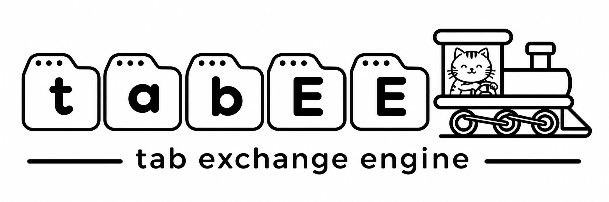

# tabEE — the tab exchange engine

[](https://www.npmjs.com/package/@tabee/browser)
[](https://github.com/Wytamma/tabee/blob/main/LICENSE)

tabEE moves datasets between two browser applications: one opens the other,
they discover matching formats, the user approves what arrives, and the
receiver imports the bytes. No backend, no shared code, and no prior knowledge
of the other side.

Browser-only. Ships a TypeScript SDK, a wire specification, and reference
sender and receiver applications.

## Install

```sh
npm install @tabee/browser @tabee/formats @tabee/protocol
```

## Packages

| Package | Purpose |
| --- | --- |
| [`@tabee/browser`](https://www.npmjs.com/package/@tabee/browser) | Browser SDK: bridge, handshake, Penpal transport, consent, sender, receiver. |
| [`@tabee/formats`](https://www.npmjs.com/package/@tabee/formats) | Format identifiers, registry entries, and capability helpers. |
| [`@tabee/protocol`](https://www.npmjs.com/package/@tabee/protocol) | Wire types, validators, negotiation, state machine, error codes. |

## Features

- **No server.** Discovery runs over `postMessage`; the receiving page is the
  application itself, not a separate endpoint.
- **Exact matching.** Formats and schemas match by identifier, never by file
  extension, media type, or content sniffing.
- **Explicit consent.** The receiver shows the dataset name, total size, every
  file with its format and size, and the sender's verified origin before any
  adapter runs.
- **Bounded transfers.** Per-file, per-format, and per-bridge limits; expiring
  offers; single-use invitation nonces.
- **Receipts.** `sendTo` resolves only after the receiver imported the dataset.
- **Bundles.** One transfer can carry up to 16 files of different formats, each
  with optional JSON metadata.

## How it works

```
Newick Sender (origin A)                       Tree Viewer (origin B)
──────────────────────                         ──────────────────────
sendTo("http://localhost:5182/", { format: "newick" })
  ├─ open B with #tabee=1&tabee-sid=<nonce>
  ├─ raw postMessage hello/hello-ack      →    verify source === opener
  │                                            take origin from event.origin
  │                                            strip nonce, connect
  ├─ getCapabilities()                    →    {newick imports}
  ├─ match the format
  ├─ offer(dataset: files, formats, sizes) →   validate, then ask the human
  │                                            shows every file, format, origin
  ├─ accept({offerId})                    ←    only after approval
  ├─ transfer(files[])                    →    re-validate sets and sizes
  └─ Receipt {formats, fileCount, bytes}  ←
```

Penpal carries the calls; tabEE owns discovery, negotiation, consent,
validation, lifecycle, and error codes. Another stack can implement the same
protocol over raw `postMessage`.

The receiving page opens as a normal tab (`window.open` with no window features)
and stays open as the working application after the import; the sender must not
close it on success.

## Quick start

```ts
import { createBridge } from "@tabee/browser";
import { NEWICK_V1, normalizeFormatKey, registryCapability } from "@tabee/formats";

const bridge = createBridge({
  application: { name: "Tree Viewer" },
  normalizeFormatKey,
  imports: {
    [NEWICK_V1]: async (files) => {
      // files: [{ name, formatId, sizeBytes, data: string | ArrayBuffer }]
      for (const file of files) loadTree(file.name, String(file.data));
    },
  },
  exports: {
    [NEWICK_V1]: () => ({
      name: "trees.newick",
      files: [{ name: "tree.nwk", data: serializeTree() }],
    }),
  },
  importCapabilities: { [NEWICK_V1]: registryCapability(NEWICK_V1) },
});

// Must be called from a user gesture: the SDK opens the receiving tab synchronously.
await bridge.sendTo("https://treeviewer.example/app", { format: "newick" });
```

A page opened with `#tabee=1&tabee-sid=…` starts the receiver automatically; the
application page itself is the receiver, so adapters see real application state.
No extra HTML entry is required.

### `createBridge(options)`

| Option | Purpose |
| --- | --- |
| `application` | `{name, url?}` shown to the other side. Display only. |
| `imports` / `exports` | Adapters keyed by registry alias or full identifier. |
| `bundles` | Named mixed-format exports; each file declares its own `formatId`. |
| `importBundle` | Receives a whole bundle; required for bundles that mix formats. |
| `importCapabilities` / `exportCapabilities` | Optional per-format limits, labels, schemas. |
| `normalizeFormatKey` | Maps aliases to identifiers (pass `normalizeFormatKey` from `@tabee/formats`). |
| `maxBytes` | Absolute ceiling for what this app sends or accepts (default 10 MB). |
| `onTransferRequest` | Replace the built-in consent dialog. Must show the same facts; anything but `true` declines. |
| `onState` / `onError` | Receiver progress and failure reporting for the app's UI. |
| `handshakeTimeoutMs`, `connectTimeoutMs`, `offerTtlMs`, `methodTimeoutMs` | Deadlines. |

Returns `{capabilities, receiver, sendTo, destroy}`. `sendTo` throws a
`TabeeException` carrying a protocol `code` and optional `details`; it resolves
with a `Receipt` only after the receiver imported the dataset.

Sender-side ambiguity is an error, not a guess: with several compatible formats
and no `format` option, `sendTo` rejects with `AMBIGUOUS_FORMAT` and lists the
candidate identifiers.

### Bundles

A bundle is 1–16 uniquely named files, and **each file declares its own
format** and may carry free-form JSON `metadata` with no schema:

```ts
bundles: {
  "tree-metadata": () => ({
    name: "tree + metadata",
    files: [
      {
        name: "tree.nwk",
        formatId: NEWICK_V1,
        data: serializeTree(),
        metadata: { source: "newick-sender", tips: 4 },
      },
      {
        name: "metadata.csv",
        formatId: CSV_V1,
        data: tableCsv(),
        metadata: { columns: ["name", "length"] },
      },
    ],
  }),
},
importBundle: (bundle, context) => {
  const tree = bundle.files.find((file) => file.formatId === NEWICK_V1);
  const table = bundle.files.find((file) => file.formatId === CSV_V1);
  render(tree, table);
},
```

- `sendTo(url, { bundle: "tree-metadata" })` sends the named bundle;
  `sendTo(url, { format: "newick" })` keeps the single-format path.
- Every file format must be declared in `exports`; the sender matches each file
  against the receiver's imports and checks schema equality per file.
- Limits are per capability: `maxFileBytes` per file, `maxBytes` for that
  format's cumulative bytes, `maxFiles` for that format's file count, plus the
  bridge-wide total.
- Single-format bundles go to the `imports[format]` adapter with all files of
  that format. Mixed bundles require `importBundle`; a receiver without it
  rejects the offer before consent.
- Per-file `metadata` is arbitrary JSON (no schema), capped at 16 KiB canonical
  JSON per file, depth 8, 64 keys, 256 array entries. The sender repeats it in
  the transfer; the receiver verifies it matches the accepted offer.
- The consent dialog lists every file with its format and size (first eight,
  then "+N more"), plus the total and the verified origin. Metadata is not
  rendered in the dialog; adapters receive it on `ImportedFile.metadata`.

`bundles` is not negotiated by name: the receiver sees formats, not bundle
identifiers, so a bundle id is purely a sender-side label.

## Examples

Hosted demos: <https://tabee.wytamma.com/>

The repository ships these standalone apps:

- **Newick Sender** — a textarea is the exported payload. Its check is
  structural only; the receiver performs the real parse. An obviously malformed
  draft is refused before a window opens.
- **Tree Viewer** — receiver only: imports Newick, renders the cladogram, and
  shows the sender origin, file count, and leaf count. It has no export,
  bundle, or file-upload path.
- **Hello Sender / Hello Receiver** — the smallest complete exchange: a private
  format identifier (`org.example.format.text.v1`), one export adapter, one
  import adapter, and no registry package or `normalizeFormatKey`.
- **Isolated Sender** — a cross-origin isolated app (`COOP: same-origin` +
  `COEP: require-corp`) and a same-origin exchange page served without those
  headers. COOP severs the handle of any window the isolated document opens, so
  it stages the tree over `BroadcastChannel`; the exchange page opens the
  receiver from its own click. Static hosts must apply the same per-path header
  split, or the app simply runs unisolated.

```sh
npm install
npm run build            # packages emit dist/; the demos import it
npm run dev -w @tabee/example-newick-sender    # http://127.0.0.1:5181
npm run dev -w @tabee/example-tree-viewer      # http://localhost:5182
npm run dev -w @tabee/example-hello-sender     # http://localhost:5185
npm run dev -w @tabee/example-hello-receiver   # http://localhost:5186
npm run dev -w @tabee/example-isolated-sender  # http://127.0.0.1:5183
```

Each app runs on a different loopback hostname or port, so every demo transfer
is cross-origin. Static hosting is enough; nothing talks to a server.

Pushes to `main` build and deploy the examples to GitHub Pages through
`.github/workflows/pages.yml`.

## Development

```sh
npm run typecheck              # packages + examples, no emit
npm test                       # Vitest unit tests, no DOM required
npx playwright install         # once, for browser tests
npm run e2e                    # Chromium, Firefox, WebKit
```

Repository layout:

```
packages/protocol   wire types, validators, negotiation, state machine (no DOM)
packages/browser    handshake, Penpal transport, sender, receiver, consent, bridge
packages/formats    format identifiers and registry
examples/newick-sender   sender only: editable Newick draft, one Send button
examples/tree-viewer     receiver only: imports Newick, renders SVG
examples/hello-sender    smallest sender: one custom format, textarea, Send
examples/hello-receiver  smallest receiver: one custom format, prints the text
examples/isolated-sender COOP-isolated app + no-COOP exchange page (two clicks)
specification/       protocol, discovery, security, format registry
tests/e2e            Playwright, two loopback origins, three engines
```

HTTPS is mandatory except on `localhost`, `127.0.0.1`, and `[::1]`, where
browsers already treat the origin as secure; development and tests need no
certificates.

## Security

The receiver never releases data on discovery alone. Before approval it sees the
bundle name, total size, every file with its format and size, and the sender's
**verified** origin (not a claim). Origins are authenticated from
`MessageEvent.origin`, bound to `window.opener`, and pinned as the only allowed
origin; the invitation nonce is single-use and stripped from the URL. Every
inbound structure is validated, every file's format and schema is matched, and
file sets, sizes, and per-file JSON metadata are checked twice. Binary exports
are copied so the sender's memory is never detached. There is no sender identity,
no payload signature, and no confidentiality from the receiver's own origin.

Read [specification/security.md](./specification/security.md) before deploying.

## Documentation

- [specification/protocol.md](./specification/protocol.md) — operations, schemas,
  state machine, error codes.
- [specification/discovery.md](./specification/discovery.md) — invitation,
  handshake, failure modes, implementing without Penpal.
- [specification/security.md](./specification/security.md) — threat model,
  controls, residual risks.
- [specification/format-registry.md](./specification/format-registry.md) —
  identifiers, matching, schemas.

## License

MIT
